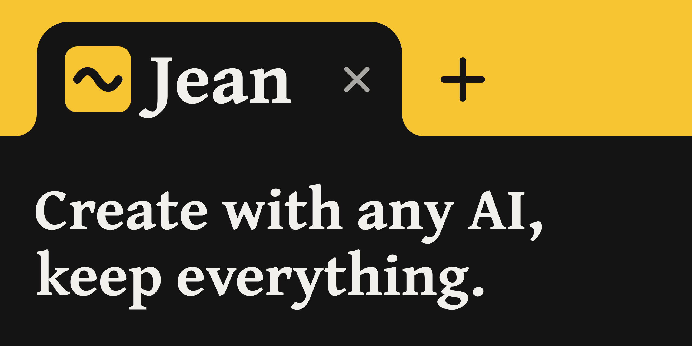

# Jean

Create with any AI, keep everything.

Ask in words or with a file, and Jean hands back what you asked for, made: an answer with its sources, a document, a spreadsheet, a chart. It works with GPT, Claude, Gemini or an AI on your own computer, and it is made for people who will never open a terminal. There is nothing to install and no Jean server: everything Jean keeps lives in your browser as plain files, and the thinking happens on your device or with a provider you choose. Free and open source.

[**Open Jean at jean.is**](https://jean.is) · [Help](https://jean.is/help) · [Why Jean exists](MANIFESTO.md)

## What Jean does

- **Reads your files:** PDF, Word, Excel, PowerPoint, CSV and text, and pictures for brains that can see.
- **Does the maths instead of guessing:** calculations run as real code, in JavaScript, Python or bash, in a sandbox inside the tab, never on your machine.
- **Hands back files you can use:** Word documents, spreadsheets, decks, charts, pictures and short films, seen beside the conversation and saved with a click.
- **Works on your folders where they are:** it finds, reads and changes files in place, shows you each change first, and undoes it if you ask.
- **Follows you from one computer to another,** through a folder in OneDrive, Dropbox, iCloud Drive or Google Drive.
- **Remembers, if you want it to:** what it should know about you, standing instructions, projects, and skills it learns from requests you repeat.
- **Reaches your services and the web,** each source a numbered citation.
- **Repeats on a schedule:** a routine is a request Jean sends itself every hour, day or week, or once later.
- **Takes on bigger tasks:** helpers work on a task's parts at once, and Double-check compares each cited claim with its source.
- **Speaks your language,** one of 46, right to left included.
- **Listens and speaks:** dictation, read-aloud and live conversation, with speech recognised on your device.
- **Asks first:** by default before sending, sharing, deleting or anything external, and it never touches passwords or payments. You choose *Do it*, *Ask me first* or *Never* for each kind of action.

Jean starts as a single box and offers each of these when you need it, like a game that teaches itself. [docs/product.md](docs/product.md) describes every feature.

## Private by design

- **Your data stays on your device,** as plain files in the browser's private file system, one file per thing. A backup is one zip you keep wherever you like; your keys are encrypted on the device and never part of it.
- **You choose the brain:**
  - **On this device:** Gemma 4 E2B on WebGPU, about 3.1 GB, downloaded once if you agree, and offered only where it can run.
  - **In one click:** sign in with OpenRouter.
  - **Your own key** for Anthropic, OpenAI or any OpenAI-compatible service, or a **local server** such as Ollama or LM Studio.
  - **A plan you already pay for:** Claude Pro or Max through Claude Code, ChatGPT Plus or Pro, or Copilot through Copilot CLI, each reached through *This computer*.
  - **Auto** picks one for each request, with Intuition, a small helper on the device, once it is on: the cheapest brain that can do the job, and the device's own for personal content or while you are offline. A switch keeps everything off the cloud.
- **Each answer says where it was done:** how long it took, what it cost, which brains answered, and whether anything left your device, with a certificate that holds none of your words.
- **Code a brain writes never runs in the page,** but in a sandboxed worker with an opaque origin and no network. The page has a strict Content Security Policy with Trusted Types.

## Good to know

- **Your data lives in this browser,** at the address you opened Jean from. Clearing the site's data clears Jean's too, so keep a backup, or a synced folder.
- **Folders and syncing need Chrome or Edge.** Elsewhere Jean works on a copy of a folder, and you save what changed.
- **Routines run while Jean is open.** What fell due while it was closed runs when you are back.
- **Browsers:** Chrome or Edge 108, Safari 16.4 or Firefox 114, or later. The brain on this device also needs WebGPU with `shader-f16`, on a computer rather than a phone or a tablet.

## Small on purpose

There is no build step: Jean is plain ES modules and an import map, with JSDoc types checked by `tsc`. Three libraries load up front, `@preact/signals-core`, `lit-html` and `marked`; everything else, QuickJS, Pyodide and Transformers.js included, loads when a capability is turned on. Every limit, on lines of code, the first load's size and the base prompt among them, is in [budgets.json](budgets.json): CI fails when one is over, and `npm run budgets` prints where each stands.

Jean speaks standards rather than inventing its own: the OpenAI-compatible and Anthropic Messages APIs for brains, MCP for connections, Agent Skills (`SKILL.md`) for skills, ACP `session/update` events for its activity, the Decisions API for Intuition, and `Intl` and the Web Platform for everything else.

## Run it yourself

With Node 22 or later:

```bash
npm install
npm run dev
```

Then open http://127.0.0.1:4173 and pick a brain. To try Jean without any account, start the fake brain the tests use, and connect it under *On your computer → Other* at `http://127.0.0.1:4174/v1`:

```bash
node test/fixtures/fake-brain.js
```

- **Host your own copy:** `npm ci && npm run build:web`, then serve `dist/web/` over HTTPS from an address that won't change. [deploy/](deploy/README.md) has the headers and a recipe for each host.
- **Reach services that refuse a browser,** such as Google Workspace or Slack, through [the gateway](docs/gateway.md).
- **Build the desktop apps** for macOS, Windows and Linux with `npm run build:desktop`: a window of the system's own web view, made with [Neutralino](https://neutralino.js.org), which needs WebKitGTK on Linux ([how it works](docs/architecture.md#desktop-app)).
- **Use Jean in your editor:** `npx jean-cli acp --folder <the folder Sync keeps>` in any editor that speaks ACP, such as Zed ([cli/](cli/README.md)).

## Contributing

Read [AGENTS.md](AGENTS.md) before writing code: it holds the rules every change follows, from the budgets to the security, data and UI rules, and every command. Before you push:

```bash
npm run check
```

It builds, type-checks, runs the tests and checks the budgets. `npm run e2e` runs the browser tests in Chromium and WebKit against the fake brain (first, once: `npx playwright install chromium webkit`). [CI](.github/workflows/ci.yml) runs both on every push and pull request, and [GitLab's](.gitlab-ci.yml) the first.

`app/` holds everything a deploy serves; the root holds what never ships: jean-cli, the gateway, the desktop and container builds, the scripts, the tests and the docs.

Bugs and questions go in [issues](https://github.com/jean-is/jean/issues). Report a vulnerability privately, as [SECURITY.md](SECURITY.md) says.

## Documentation

| Document | What's in it |
|---|---|
| [MANIFESTO.md](MANIFESTO.md) | Why Jean exists, in one page |
| [docs/product.md](docs/product.md) | The user, the vocabulary, progressive discovery, and how every feature behaves |
| [docs/architecture.md](docs/architecture.md) | Stack, data, security, brains, languages, events |
| [docs/design.md](docs/design.md) | Jean's identity, Tilde, its wave, and the themes |
| [docs/enterprise.md](docs/enterprise.md) | Policy, gateways, what is open and what is enterprise, and what the architecture allows later |
| [docs/trust/](docs/trust/README.md) | For an organisation's IT, security and privacy teams: the threat model, signed releases, a DPIA template, how accessibility is checked |
| [deploy/](deploy/README.md) | Hosting a copy of Jean: the headers, the types, and a recipe for each host |
| [docs/gateway.md](docs/gateway.md) | Running the gateway, and what each service needs |
| [cli/](cli/README.md) | jean-cli: Jean in an editor, and the gateway from npm |
| [docs/sharing.md](docs/sharing.md), [docs/encryption.md](docs/encryption.md), [docs/certificates.md](docs/certificates.md) | Sharing by link, encryption at rest and answer certificates, each with its work left |
| [docs/roadmap.md](docs/roadmap.md) | The versions, what is still to check by hand, and what the launch needs |
| [docs/decisions.md](docs/decisions.md), [docs/open-questions.md](docs/open-questions.md) | Every decision as it stands, by topic, with the alternatives that were rejected; and what is still undecided |
| [docs/background.md](docs/background.md) | Where Jean comes from (DEVS), and the field as of 2026-10-01 |

## License

Jean is open source under the [MIT license](LICENSE). The enterprise integrations in [`app/ee/`](app/ee/) are under the [Elastic License 2.0](app/ee/LICENSE) and need a key. An [additional grant](app/ee/GRANT.md) makes them MIT if keys can't be bought for twelve months (D139).
