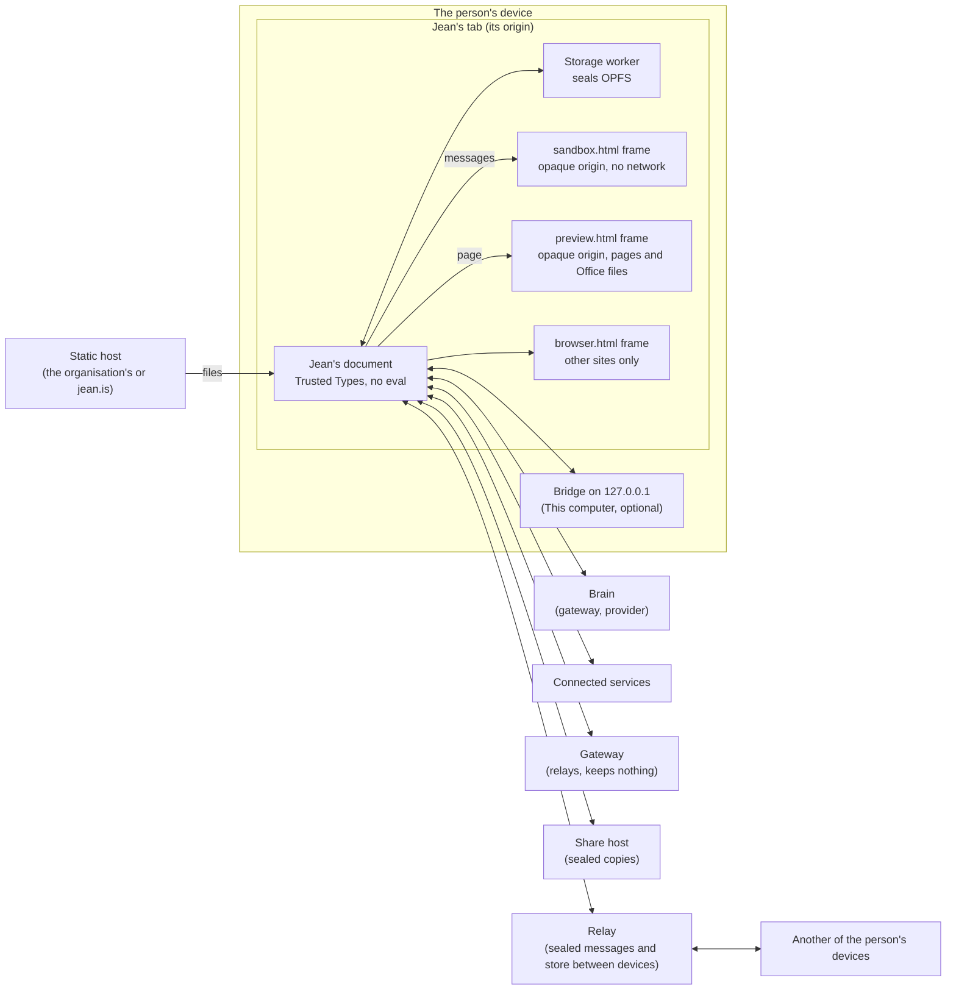

# Threat model

What Jean protects, from whom, what stops each threat, and what is left to the organisation that deploys it. For a security team reviewing a pilot, and for anyone changing one of Jean's boundaries, who updates this file in the same change. Last reviewed 1 November 2026.

## Jean in one paragraph

Jean is static files served from one address. It runs in the person's browser tab and keeps everything on their device, in the browser's private file system for that address, sealed at rest. It sends something out only to the brain that answers (a provider, the organisation's gateway, or none, for the brain on the device), the services the person connects and the sites they open; if they share, to a host that keeps sealed copies it can't read; and if they add another of their devices, to that device, through the relay policy names, which passes messages sealed from one device's key to the other's and, where its configuration keeps stores, keeps their tasks and files sealed under keys only their devices hold (D721). There is no Jean server that keeps what people do in Jean in a form it can read, except a site they publish, which is for anyone to read. The [architecture](../architecture.md#security) has the detail; [Where your files go](../../site/files/en.html) names every address Jean contacts.

## What Jean protects

| Asset | Where it lives |
|---|---|
| What the person writes, the files they give, what Jean makes, its memory | The device, in OPFS, each file sealed with AES-256-GCM ([encryption.md](../encryption.md)); once they add another of their devices, that device, and the store the relay keeps for them, sealed under keys only their devices hold (30) |
| Keys and sign-ins: brains' keys, connections' tokens, the organisation's sign-in | `.secrets/`, sealed as every file is, never in a backup, export, sync or share; the keys the person typed for their own brains in the cloud, connections and search services, and published sites', also on each device the person adds, never a sign-in's tokens (29) |
| What Jean does on the person's behalf: sending, sharing, deleting, changing their files | Decided by the rules (Do it, Ask me first, Never) before each call |
| The organisation's policy: which brains, which capabilities, which rules | `policy.json` beside Jean, and the site's own HTTP headers |
| The record of what happened | The conversation's file, and with `ee/`, the organisation's collector (D386) |

## Who might attack

- **Content that carries instructions:** a web page, a document, a mail read through a connection, a skill, a task someone shared, a colleague's request. The most likely threat for any assistant that reads and acts.
- **A brain that does the wrong thing:** told by such content, or mistaken.
- **Code Jean runs:** scripts a brain wrote, pages in answers, extensions.
- **A malicious site** in Jean's browser pane.
- **Someone with the device:** a lost laptop, a shared computer, another profile.
- **A service on the way:** a brain's provider, the gateway, the share host, the relay between the person's devices, a browser's push service it nudges (D736), a connected service, the network.
- **Whoever serves Jean's files,** or a package Jean is built from.
- **The person themself,** getting around their organisation's policy.

## Boundaries

Jean's document is the only part with its origin's storage and network. Everything it didn't write runs in a frame of an opaque origin, which has neither, and reaches the rest only through messages Jean checks.

## Threats and what stops them

### Content Jean reads

| # | Threat | What stops it | What is left |
|---|---|---|---|
| 1 | Instructions in content make Jean send, share, delete or change something | Sending, sharing, deleting and anything external ask first by default, checked before each call, a script's nested calls included (`core/loop.js`, D48). Passwords and payments are Never, and no hook, app or project loosens them (D293). The organisation's rules come first and are locked (D295). Once a task holds something from elsewhere, an Always allow no longer sends anything out unasked, and the card says why (D673). A shared task, or a colleague's request, arrives marked as someone else's, to read as data, and in a received task every call to a connected service asks first whatever the rules (D361, D45). | Before anything comes in, and for changes in a folder they always allowed, a person's Always allow stands. Files in their own folder count as theirs, so instructions in a repository they cloned aren't held by this. A person may approve what they didn't read. |
| 2 | Instructions make Jean leak data through an address it loads | An answer draws a picture only from the address a source gave, loading the source's own copy, never an address the brain wrote (D35, D336). Links load only when clicked. `browse` asks first. The Computer reaches the internet through Jean, https only, never Jean's origin or a private address unless listed, asking once a run for each new site (D162). Pages in answers have no network unless the person allows it, and no WebRTC (D267). Once a task holds something from elsewhere, an address neither the person nor what was read gave as it is asks, whatever Always allow said (D673). | A link the person clicks carries what is in it. A brain choosing among addresses a page gave can still say a little by its choice, and a brain's own search through a provider that cites nothing leaves no mark. A brain's own web search (Anthropic's, OpenRouter's) sends its queries to that provider. A connected service's call, once approved, carries what the brain put in it. |
| 3 | A skill from elsewhere carries instructions | A skill is instructions the brain reads, so whatever it leads to is held by the same rules (1, 2). Its source and digest are kept with it. | As 1. |

### Code Jean runs

| # | Threat | What stops it | What is left |
|---|---|---|---|
| 4 | Code a brain wrote reaches Jean's storage, keys or the network | It runs only in a worker started from a blob by `sandbox.html`, framed with `sandbox="allow-scripts"` alone: an opaque origin, `connect-src 'none'`, nothing but what Jean posts in, its requests made by Jean under the Computer's rules (D13 · D65 · D162). `test/html.test.js` checks the policy's hash and that no frame of Jean's own gets `allow-same-origin`. | A flaw in the browser's own sandbox. |
| 5 | A page in an answer, or an Office file, attacks the person | `preview.html`, an opaque frame with `allow-scripts allow-forms` only: `form-action 'none'`, no pop-ups, no top navigation, no network unless allowed in Settings › Approvals, WebRTC deleted from its window, files saved only through Jean after a click (D126 · D143 · D267). | A page can draw a convincing imitation of something else inside its frame; with no network allowed, what is typed there goes nowhere. |
| 6 | An extension does more than it said | Each runs in a `sandbox.html` frame of its own, with no network, reaching only the events its rights cover; its card shows what it asks, loosening named apart; it never loosens a reserved action or an organisation's rule (D296). `capabilities.deny` in policy turns extensions off. | An extension granted `loosen` lets calls through without asking, within its rights. |

### Jean's own document

| # | Threat | What stops it | What is left |
|---|---|---|---|
| 7 | Script injection into Jean's document | No `innerHTML`, `eval` or `new Function`; Markdown drawn from `marked`'s tokens into lit-html; Trusted Types enforced, with two policies, `lit-html` and `app-urls`; `script-src 'self'` and three inline scripts by hash; `object-src 'none'`, `base-uri 'none'`, `form-action 'none'` (D29). Every page's policy is checked in every engine by the browser's own reports (D326). `npm run security`, in CI, holds these rules in the code (D679), and CodeQL looks further on GitHub. | A flaw in lit-html, or in Jean's two Trusted Types policies, would reach everything the document holds, keys and sign-ins included. |
| 8 | A sign-in's tokens are taken | OpenID Connect and OAuth with PKCE from the browser; tokens kept in `.secrets/`, sealed; the organisation's access token goes only to the policy's brains that ask for it (`auth: "oidc"`, D385). | As 7. |

### The device

| # | Threat | What stops it | What is left |
|---|---|---|---|
| 9 | Someone copies Jean's files off the disk, or out of a backup of the browser's profile | Each file is sealed under a key of its own, derived from the vault key, which is sealed under a non-extractable key of the browser's (D371). | Nothing more is needed to open them in the person's own session. |
| 10 | Someone opens Jean on an unlocked computer | A lock keeps the vault key behind the person's passkey or password, with a recovery code; `"lock": "required"` in policy asks for one at the first run and hides Turn off (D371); `session.idle` locks every tab, or signs out, once nobody has done anything for that long, with `ee/` (D676). | Without a lock, whoever uses the browser as the person uses Jean as them, and, where policy names a relay and signs no one in, can add a device of theirs, which then gets the keys and settings that follow until the person removes it (29). A password can be any length, policy's `required` included, so a short one can be guessed from a copy of the profile; a passkey can't. Malware running as the person is outside what a web page can stop. |
| 11 | Keys leak through a backup, an export, a sync or a share | `.secrets/` is never in any of them (`test/secrets.test.js`, `test/backup.spec.js`, `test/sync.spec.js`). | Backups and Sync's folder are readable copies of everything else, by design ([encryption.md](../encryption.md)): where they go is the organisation's choice. |
| 12 | Another profile on the device reads this one | Each profile is a whole Jean with its own vault and lock; nothing crosses (D228). | A profile without a lock is open to anyone at that browser. |
| 27 | The next person at a shared computer finds the last one's work | With `ee/`, `session.signOut: "wipe"` erases the profile as the person signs out, once they confirm (D676). | Someone who walks away without signing out leaves it, behind the lock if there is one. Backups and Sync's folder are elsewhere. |
| 13 | Data is lost: the browser evicts it, the person clears it | `navigator.storage.persist()`, installing the app, backups offered early, Sync to a folder (D157). | There is no copy elsewhere unless the person or the organisation makes one. |
| 25 | The camera films more than the person meant, or stays on | It opens only from the person's own tap, never the brain's; nothing streams: only the pictures Jean looks at go to the brain and stay in the task, a look that says nothing leaving none. It says that it is on all the while, and stops on another task, after ten idle minutes, or when the page is hidden, where it waits for a tap (D645). `capabilities.deny` in policy turns it off. | What it shows when the person speaks goes to their brain, people nearby included. |

### Where Jean comes from

| # | Threat | What stops it | What is left |
|---|---|---|---|
| 14 | Whoever serves Jean's files changes them | An organisation serves its own copy, from a signed release whose signature and sums it checks before deploying ([releases.md](releases.md), D419), or built from a commit itself. A deploy is a commit, never a working tree (D320). The service worker checks every file against the hashes in `capabilities.json`. | The hashes come from the same server, so they catch a damaged file, not a hostile server. Browsers have no code signing for web apps: whoever controls the address controls the code, Warehouse SAS for a copy it hosts ([hosted.md](hosted.md)). |
| 26 | What the terminal runs isn't the bridge | The line runs what it fetched only if it has the hash the page knows, never half a file (D677). | The hash comes from the page, so it holds against a change or a cut on the way, or after the page loaded, not against a hostile server when it loaded. |
| 15 | A package Jean is built from is malicious | Three libraries load upfront; the rest load inside the capability that needs them, each added only with a decision. Versions are pinned by the lockfile and copied into `app/vendor/` at build, never fetched from a CDN at run time. CI runs `npm audit signatures` and `npm audit --audit-level=high`, and keeps a CycloneDX bill of materials, as each release does; its own actions are named by commit, never by a tag that can move (D679). | A malicious version the registry signed, until someone reads the update. |
| 16 | Someone on the network reads or changes traffic | HTTPS, with `Strict-Transport-Security` in every recipe ([deploy/](../../deploy/README.md)); plain HTTP only to this computer (D260); the Computer's internet https only. | An organisation's own TLS inspection is the organisation's. |

### Services Jean talks to

| # | Threat | What stops it | What is left |
|---|---|---|---|
| 17 | A brain's provider reads or keeps what it is sent | It is sent what it must answer, by design. Policy pins brains to the organisation's gateway and locks them (`brains`), behind its sign-in (D385); the brain on the device keeps everything there. Each answer says where it was done (D252). | What a provider keeps is set by its contract with whoever pays it. |
| 18 | The gateway sees what it relays, sign-in codes included | It keeps nothing (no logs, no database), relays only for Jean's origins to the hosts it allows, and holds registered apps' secrets so no browser gets them (D191). A redirect to another address takes no credentials with it, and a request holding a secret goes nowhere but where it was sent; what it relays can't run as a page of its address. An organisation runs its own (`node gateway/serve.js`) or none (`urls.gateway: ""`). | It is trusted with what passes through it while it passes. |
| 19 | The share host reads a shared copy | The copy is sealed in the browser with AES-256-GCM under a key in the link's `#`, which browsers never send; a password adds PBKDF2 at 600,000 rounds and ten tries an hour, however many come at once; the host keeps a hash of the write token (D361, [sharing.md](../sharing.md)). An organisation turns sharing off (`rules.share: "never"`) or runs its own host (`npm run host`). | Anyone holding the link reads the copy, and links travel. The host sees sizes, times and the sharer's address. |
| 29 | Someone pairs a device of theirs into the person's Jean, or reads what pairing carries | Everything between devices is sealed from one device's key to the other's (ECDH P-256, HKDF, AES-GCM); the relay keeps sealed messages for 7 days and a hash of each mailbox's token, never a key or a name. The link's secret travels after `#`, which browsers never send. The person types on the old device the six digits the new one shows, drawn from all that crossed after a nonce committed to, so holding the link and the relay lets no one try keys until a code matches, and three wrong tries end it; the pairing mailbox takes one message, so a photographed or forwarded link opened second gets 409 and says it was used. On the new device a link alone does nothing: it says what joining does and waits for Join, then names the profile and the device it came from and asks again before opening it. The bundle is taken only from the key the link names, and later messages only from keys the profile lists and hasn't removed; that list is kept with the keys, which neither Sync nor backups carry, so writing in the person's synced folder adds no device (D700). The old device keeps the new one only once it says it opened the profile. A removed device is dropped here at once and the others are told before it is, so what it sends them after hearing comes after its removal; it can't fill a still-paired device's profile in place. A child's profile and a copy whose policy signs in don't pair. | Whoever opens the link first and gets the person to type the digits they show is paired: the code proves the two screens match, not whose the other device is. The relay sees when devices talk, sizes and addresses, and keeps the address each change came from a year, as French law asks of a host, sealed when its configuration names a record key. A stolen device gets each key and setting that changes until the person removes it, and can fill a mailbox up to the relay's fair share until that removal reaches every device. Keys that crossed can't be taken back from a removed device: Jean lists them, to replace. A device away longer than the relay keeps messages (7 days) learns of a removal only from a later message of another device, and until then still trusts the removed one. |
| 30 | The relay that keeps a person's store reads it, changes it, empties it, or lets a removed device back in | Each file and meta is sealed on the devices under the epoch's key, bound to its path or its object, and parts are named by the SHA-256 of their sealed bytes, so the relay can neither read, name nor swap them; an object's id is an HMAC of its path under a key the relay never sees; a deletion is a sealed version, so no file goes on the relay's word; a 403 or 404 stops the rounds and erases nothing. Removing a device starts a new epoch whose key goes only to the devices the remover's own list still has, sealed from its key, with every device removed so far and when the epoch began: readers refuse a version sealed under an older epoch after that, and never send the keys to a device an epoch named (D721). | The relay sees sizes, counts, timing and how often an object changes, and can withhold or roll back what it keeps. A removed device keeps what it already had, and with the relay's help can still tell when an object it knew the path of changes, since the naming key never changes. A write that lands between the remover reading the store and starting the epoch is taken as the removed device's would be. Writes from a device whose list still trusts a stolen one go on until the removal reaches it. |
| 31 | Someone met by People is impersonated, a stranger slips into the person's people, or a removed device keeps reading what people send | People meet on pairing's exchange (D727): a link's secret, a mailbox opened once, six digits over everything that crossed and both names, typed on the inviter's side, three tries; nothing reaches either before the digits. What goes between people is sealed from one profile key to the other, anything from a key no one met dropped, and a received task's requests are theirs, a service's call there asking first. Removing a device turns the profile's key: a new pair and mailbox, the old mailbox deleted, the chain from the old key riding on every message until each person takes it; a second, different turn from the same key marks the person to meet again; the removal lists the people met, to remove any the removed device planted. | A message sealed to the old key before the turn can still be opened by the removed device if it read it first; until a person reads the chain, what they send goes to a mailbox that is gone, so it reaches no one. |
| 33 | Someone holding a link to work on something together joins it, a removed member keeps reading it or changing it, or a member's changes are forged | A link is its owner's choice, to edit or to view, and joins show as they come (D733). Every change is signed by its member's profile key and sealed under the circle's key; a copy takes it only from a member who may make it, never twice. Removing someone moves everyone else to a new journal under a key sealed to each of them, which the removed member can't open; the relay keeps sealed changes, never a key or a name, for 7 days after the last. | Anyone holding a link to edit can join and post until removed, as a link means: Remove and Turn the link off answer it. The relay sees each journal's sizes, timing and how many read it, and which journals one tab reads together (D737), as its address and timing already told it. A member's seed is believed for what it holds of the thing, never for who is in. |
| 32 | At work, someone lists a key of their own under a colleague's name on the organisation's relay, or reads who sends to whom | The relay lists a device only with an ID token its issuer signed, checked there (signature by `kid` with the issuer's keys, never `none` or HS*, issuer, audience and `azp`, dates within a minute) and dropped, and only where its configuration names that issuer (D731). A colleague's devices are pinned when they are added; a letter from a key no one met is taken only when the list names that key at the mailbox the letter gives, and a new device of someone kept is held, nothing sent to it and nothing it sent shown, until the person trusts it. A device lapses 30 days after its last proof, and `forget` takes a leaver off at once. With `ee/`'s `colleagues.certify` (D732), a colleague's device counts only while its key carries a certificate from the organisation's authority naming their account and leading to policy's `trust`, so neither the relay nor a stolen ID token can list a key under their name. | Without `certify`, the relay vouches for the keys it lists: someone holding a colleague's ID token for its hour can list a device as them, which anyone who never met them would take on its first letter. Each letter names its sender's key, which the list holds, so the relay can tell who sends to whom among colleagues, never what. Groups kept apart (`apart`) hold in each person's Jean, as policy does; the relay lists whomever the sign-in names. |
| 20 | A connected service's answer carries instructions, or its tool does more than it says | Its answers are content (1, 2); its tools ask first by default, read-only ones too; tokens are per account and per project (D89, D194). | As 1. |

### Beside Jean

| # | Threat | What stops it | What is left |
|---|---|---|---|
| 21 | A site in the browser pane attacks Jean | It is framed inside `caps/browser/browser.html`, a document with no script, never at Jean's origin, a blob or data; without top navigation or a referrer, with a fresh frame for each address; Jean's tab calls off a navigation to the site for 3 seconds after it loads (D140). `test/html.test.js` checks that no other frame combines `allow-scripts` and `allow-same-origin`. Jean's document doesn't open inside another site's page, whatever the headers say (D678). | The site keeps its own cookies and storage, as in any tab. In the Mac app, the setting that shows sites refusing frames is the whole web view's (D160): a site in the pane can frame another site there, which loses that protection inside Jean. |
| 22 | A program on the computer drives the bridge or the desktop app | The bridge listens on 127.0.0.1 only, answers Jean's origin only, and needs the key in the line the person pasted, in its environment, where another user's `ps` can't read it and nothing it starts inherits it (D677); it runs only what the rules let through, and ends with Ctrl+C (D198). The desktop app's native calls are twelve, behind a key it hands Jean at start (D155). | A program running as the person can already do what the bridge does. |

### The organisation's control

| # | Threat | What stops it | What is left |
|---|---|---|---|
| 23 | The person gets around the organisation's policy | Policy wins over the person's settings and locks what it sets; offline, the last policy read holds (`app-policy`). A group's section applies from the groups the sign-in's token gave, and a token too full to say them stops Jean (D429). Enforcement lives outside Jean: the site's `Content-Security-Policy` header, which only narrows (`connect-src 'self' https://ai.corp.example` keeps Jean to the gateway), and the gateway's own sign-in and checks ([enterprise.md](../enterprise.md)). | Rules inside a browser are advisory: a person with developer tools changes what their tab does, within what the header and the gateway allow. |
| 24 | What happened can't be shown afterwards, or is changed later | Each call keeps whose rule decided it (D299, D308). With `ee/`, each turn goes to the organisation's collector as a trace (D386), each span chained to the last and each batch's end signed with a key the browser can't export, which `ee/verify.js` checks under keys pinned when first seen (D675), and policy's `retention` keeps what leaves a task its period (D412). | The export is best effort from a device the person controls, and the chain shows a copy changed since, not a device that lied. The newest spans until a batch signs them, and the newest or oldest chains removed whole, can't be told from what was never sent. The gateway's log is the authoritative one. |
| 28 | What must stay in the organisation leaves it | With `ee/`, `dlp` finds on the device what policy names: a task holding it reaches only the brains allowed, or one on this computer, and a call sending it out asks first or never runs (D674). | Words only, no pictures, nothing encoded, nor answers or shares (`rules.share`). A person can reword or copy it out: the gateway and network decide in the end. |
| 28b | A value hidden from a brain leaves all the same | With `dlp.mask` (D681): marks are made on the device, per task, with a key that never leaves; a last look refuses a request still holding what it knows, however encoded; failing anywhere before the request fails the step; a hidden value in a call that would leave asks whatever Always allow said; only what the brain itself wrote is replayed as its thinking. | What no list, pattern or model finds goes as it is (about 97 to 100% of names were found on written documents in English, French, German and Spanish, `npm run masks`), and context can say who it is: it is masked, not anonymous. A link the person clicks carries what's in it. The model's files are pinned to a commit and checked by hash when first fetched. |

## Out of scope

- The operating system, the browser and its extensions. A malicious extension reads every page. Managed browsers restrict them (`ExtensionInstallAllowlist`, `DeveloperToolsAvailability`).
- What brains' providers and connected services do with what they are sent, beyond choosing which ones Jean may use.
- jean.is's own servers when an organisation serves its own copy with its own gateway, and its own share host and relay or none: then nothing of the organisation's passes through them. A copy Warehouse SAS hosts is served from one of them: [hosted.md](hosted.md) says what it sees and keeps.

## What the organisation adds

| Control | Where |
|---|---|
| Serve its own copy from a signed release | [releases.md](releases.md), [deploy/](../../deploy/README.md) |
| Narrow every address Jean may reach | The `Content-Security-Policy` header ([deploy/README.md](../../deploy/README.md#the-header-set)) |
| Pin brains to its gateway, behind its sign-in | `brains`, `signIn` in policy ([enterprise.md](../enterprise.md#signing-in-at-work)) |
| Lock rules, deny capabilities, turn sharing off | `rules`, `capabilities.deny`, `rules.share` in policy |
| Set them by team | `groups` in policy, from the directory's groups and app roles, with an `ee/` key ([enterprise.md](../enterprise.md#policy-by-group)) |
| Require a lock, lock when idle, erase at sign-out | `"lock": "required"`, and with an `ee/` key `session` in policy ([enterprise.md](../enterprise.md#sessions)) |
| Keep sensitive data from brains and services | `dlp` with an `ee/` key ([enterprise.md](../enterprise.md#data-loss-checks)), masked rather than refused with `dlp.mask` ([enterprise.md](../enterprise.md#masked-requests)) |
| Run its own gateway, share host and relay, or none | `urls.gateway`, `urls.share`, `urls.relay` |
| Keep a record | `audit`, `retention` with an `ee/` key |
| Check the site as deployed | `policy.html` at its address (D415) |
