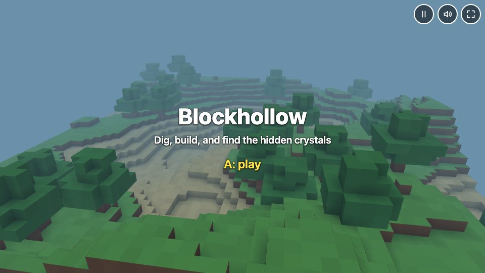
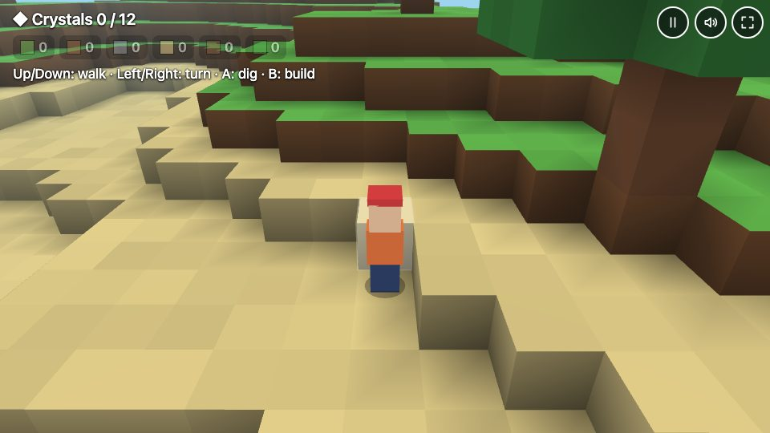
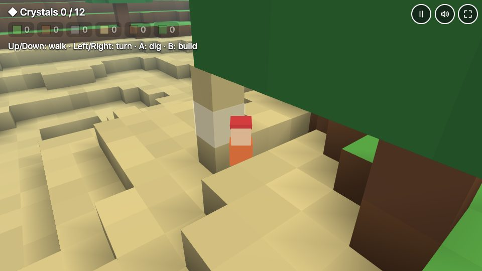

# The proof game: Blockhollow

Made unguided by Jean's skill "Make a game" on 28 October 2026, as the plan's last phase asked: one request, nothing else from a person, and no line of it changed by hand. It is kept here as an example of what the skill makes.

- **The request:** "Make me a 3D game where I explore a world made of blocks, dig them out and build with them." This is `blocks` in [set.json](../set.json), in English.
- **The brain:** Claude Opus, through the owner's Claude Code, in Jean's own page in headless Chromium: `BRAIN=claudecode:opus npm run games -- --only blocks --lang en`.
- **What it did:** it read the skill and its 3D sheet, wrote the design card, built the game on Babylon.js with `game`, and handed it over once its first play-test found nothing to fix, in 6 minutes and 95k tokens. The conversation as it had it, the skill's steps included, is [conversation.md](conversation.md).
- **The game** ([blockhollow.game.html](blockhollow.game.html)):
  - a hilly world of blocks, seen over the shoulder of a small explorer;
  - each block dug out is kept, to build with;
  - 12 crystals lie a few blocks deep, sparkles on the grass pointing to them;
  - it can't be lost: finding all twelve wins, and the world goes on;
  - it saves itself, and its title offers to carry on or start a new world.

| Gate | Met |
|---|---|
| Its last play-test has nothing to fix | Yes, the first: every control changed the picture |
| Its moments | Cover, title, play in its play-test; it wins once the twelfth crystal is out, which a seven-second play-test doesn't reach |
| Keys and a touch screen | Keys in its play-test, the frame's touch buttons in [games.spec.js](../../games.spec.js), in Chromium and WebKit |
| Less motion | Blocks don't squash as they break or land, and the title's camera stops turning, when `host.reduced` is true |
| Its words in the person's language | English, as asked |
| Original | Its own name, explorer, goal and look; the judge, Sonnet, reads it as a game of a famous title's genre, which is what the request asks for |

A first attempt that day, Blockhaven, was clean too, but its help covered its list of blocks for the first twelve seconds of play, which the play-test couldn't see. The play-test now reports words over other words, and Blockhollow is the attempt after it.

| Title | Play | Dug in |
|---|---|---|
|  |  |  |
