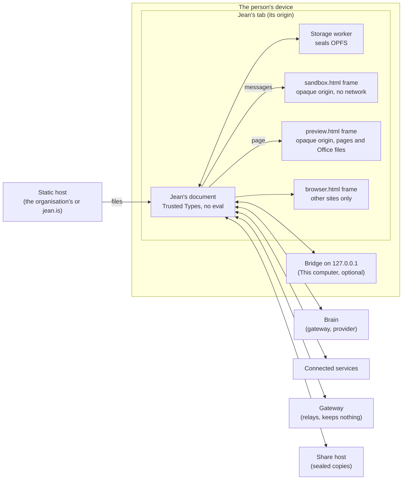

# Threat model

What Jean protects, from whom, what stops each threat, and what is left to the organisation that deploys it. For a security team reviewing a pilot, and for anyone changing one of Jean's boundaries, who updates this file in the same change. Last reviewed 18 October 2026.

## Jean in one paragraph

Jean is static files served from one address. It runs in the person's browser tab and keeps everything on their device, in the browser's private file system for that address, sealed at rest. It sends something out only to the brain that answers (a provider, the organisation's gateway, or none, for the brain on the device), the services the person connects, the sites they open, and, if they share, a host that keeps sealed copies it can't read. There is no Jean server holding anyone's data. The [architecture](../docs/architecture.md#security) has the detail; [Where your files go](../app/files.html) names every address Jean contacts.

## What Jean protects

| Asset | Where it lives |
|---|---|
| What the person writes, the files they give, what Jean makes, its memory | The device, in OPFS, each file sealed with AES-256-GCM ([encryption.md](../docs/encryption.md)) |
| Keys and sign-ins: brains' keys, connections' tokens, the organisation's sign-in | `.secrets/`, sealed as every file is, never in a backup, export, sync or share |
| What Jean does on the person's behalf: sending, sharing, deleting, changing their files | Decided by the rules (Do it, Ask me first, Never) before each call |
| The organisation's policy: which brains, which capabilities, which rules | `policy.json` beside Jean, and the site's own HTTP headers |
| The record of what happened | The conversation's file, and with `ee/`, the organisation's collector (D386) |

## Who might attack

- **Content that carries instructions:** a web page, a document, a mail read through a connection, a skill, a task someone shared, a colleague's request. The most likely threat for any assistant that reads and acts.
- **A brain that does the wrong thing:** told by such content, or mistaken.
- **Code Jean runs:** scripts a brain wrote, pages in answers, plugins.
- **A malicious site** in Jean's browser pane.
- **Someone with the device:** a lost laptop, a shared computer, another profile.
- **A service on the way:** a brain's provider, the gateway, the share host, a connected service, the network.
- **Whoever serves Jean's files,** or a package Jean is built from.
- **The person themself,** getting around their organisation's policy.

## Boundaries

Jean's document is the only part with its origin's storage and network. Everything it didn't write runs in a frame of an opaque origin, which has neither, and reaches the rest only through messages Jean checks.

## Threats and what stops them

### Content Jean reads

| # | Threat | What stops it | What is left |
|---|---|---|---|
| 1 | Instructions in content make Jean send, share, delete or change something | Sending, sharing, deleting and anything external ask first by default, checked before each call, a script's nested calls included (`core/loop.js`, D48). Passwords and payments are Never, and no hook, plugin or project loosens them (D293). The organisation's rules come first and are locked (D295). A shared task, or a colleague's request, arrives marked as someone else's, to read as data, and in a received task every call to a connected service asks first whatever the rules (D361, D45). | A person who chose Always allow for a kind of action has given that up for it. A person may approve what they didn't read. |
| 2 | Instructions make Jean leak data through an address it loads | An answer draws a picture only from the address a source gave, loading the source's own copy, never an address the brain wrote (D35, D336). Links load only when clicked. `browse` asks first. The Computer reaches the internet through Jean, https only, never Jean's origin or a private address unless listed, asking once a run for each new site (D162). Pages in answers have no network unless the person allows it, and no WebRTC (D267). | A link the person clicks carries what is in it. A brain's own web search (Anthropic's, OpenRouter's) sends its queries to that provider. A connected service's call, once approved, carries what the brain put in it. |
| 3 | A skill from elsewhere carries instructions | A skill is instructions the brain reads, so whatever it leads to is held by the same rules (1, 2). Its source and digest are kept with it. | As 1. |

### Code Jean runs

| # | Threat | What stops it | What is left |
|---|---|---|---|
| 4 | Code a brain wrote reaches Jean's storage, keys or the network | It runs only in a worker started from a blob by `sandbox.html`, framed with `sandbox="allow-scripts"` alone: an opaque origin, `connect-src 'none'`, nothing but what Jean posts in, its requests made by Jean under the Computer's rules (D13 · D65 · D162). `test/html.test.js` checks the policy's hash and that no frame of Jean's own gets `allow-same-origin`. | A flaw in the browser's own sandbox. |
| 5 | A page in an answer, or an Office file, attacks the person | `preview.html`, an opaque frame with `allow-scripts allow-forms` only: `form-action 'none'`, no pop-ups, no top navigation, no network unless allowed in Settings › Approvals, WebRTC deleted from its window, files saved only through Jean after a click (D126 · D143 · D267). | A page can draw a convincing imitation of something else inside its frame; with no network allowed, what is typed there goes nowhere. |
| 6 | A plugin does more than it said | Each runs in a `sandbox.html` frame of its own, with no network, reaching only the events its rights cover; its card shows what it asks, loosening named apart; it never loosens a reserved action or an organisation's rule (D296). `capabilities.deny` in policy turns plugins off. | A plugin granted `loosen` lets calls through without asking, within its rights. |

### Jean's own document

| # | Threat | What stops it | What is left |
|---|---|---|---|
| 7 | Script injection into Jean's document | No `innerHTML`, `eval` or `new Function`; Markdown drawn from `marked`'s tokens into lit-html; Trusted Types enforced, with two policies, `lit-html` and `app-urls`; `script-src 'self'` and three inline scripts by hash; `object-src 'none'`, `base-uri 'none'`, `form-action 'none'` (D29). Every page's policy is checked in every engine by the browser's own reports (D326). | A flaw in lit-html, or in Jean's two Trusted Types policies, would reach everything the document holds, keys and sign-ins included. |
| 8 | A sign-in's tokens are taken | OpenID Connect and OAuth with PKCE from the browser; tokens kept in `.secrets/`, sealed; the organisation's access token goes only to the policy's brains that ask for it (`auth: "oidc"`, D385). | As 7. |

### The device

| # | Threat | What stops it | What is left |
|---|---|---|---|
| 9 | Someone copies Jean's files off the disk, or out of a backup of the browser's profile | Each file is sealed under a key of its own, derived from the vault key, which is sealed under a non-extractable key of the browser's (D371). | Nothing more is needed to open them in the person's own session. |
| 10 | Someone opens Jean on an unlocked computer | A lock keeps the vault key behind the person's passkey or password, with a recovery code; `"lock": "required"` in policy asks for one at the first run and hides Turn off (D371). | Without a lock, whoever uses the browser as the person uses Jean as them. Malware running as the person is outside what a web page can stop. |
| 11 | Keys leak through a backup, an export, a sync or a share | `.secrets/` is never in any of them (`test/secrets.test.js`, `test/backup.spec.js`, `test/sync.spec.js`). | Backups and Sync's folder are readable copies of everything else, by design ([encryption.md](../docs/encryption.md)): where they go is the organisation's choice. |
| 12 | Another profile on the device reads this one | Each profile is a whole Jean with its own vault and lock; nothing crosses (D228). | A profile without a lock is open to anyone at that browser. |
| 13 | Data is lost: the browser evicts it, the person clears it | `navigator.storage.persist()`, installing the app, backups offered early, Sync to a folder (D157). | There is no copy elsewhere unless the person or the organisation makes one. |

### Where Jean comes from

| # | Threat | What stops it | What is left |
|---|---|---|---|
| 14 | Whoever serves Jean's files changes them | An organisation serves its own copy, from a signed release whose signature and sums it checks before deploying ([releases.md](releases.md), D419), or built from a commit itself. A deploy is a commit, never a working tree (D320). The service worker checks every file against the hashes in `capabilities.json`. | The hashes come from the same server, so they catch a damaged file, not a hostile server. Browsers have no code signing for web apps: whoever controls the address controls the code. |
| 15 | A package Jean is built from is malicious | Three libraries load upfront; the rest load inside the capability that needs them, each added only with a decision. Versions are pinned by the lockfile and copied into `app/vendor/` at build, never fetched from a CDN at run time. CI runs `npm audit signatures` and `npm audit --audit-level=high`, and keeps a CycloneDX bill of materials, as each release does. | A malicious version the registry signed, until someone reads the update. |
| 16 | Someone on the network reads or changes traffic | HTTPS, with `Strict-Transport-Security` in every recipe ([deploy/](../deploy/README.md)); plain HTTP only to this computer (D260); the Computer's internet https only. | An organisation's own TLS inspection is the organisation's. |

### Services Jean talks to

| # | Threat | What stops it | What is left |
|---|---|---|---|
| 17 | A brain's provider reads or keeps what it is sent | It is sent what it must answer, by design. Policy pins brains to the organisation's gateway and locks them (`brains`), behind its sign-in (D385); the brain on the device keeps everything there (D270). Each answer says where it was done (D252). | What a provider keeps is set by its contract with whoever pays it. |
| 18 | The gateway sees what it relays, sign-in codes included | It keeps nothing (no logs, no database), relays only for Jean's origins to the hosts it allows, and holds registered apps' secrets so no browser gets them (D191). An organisation runs its own (`node gateway/serve.js`) or none (`urls.gateway: ""`). | It is trusted with what passes through it while it passes. |
| 19 | The share host reads a shared copy | The copy is sealed in the browser with AES-256-GCM under a key in the link's `#`, which browsers never send; a password adds PBKDF2 at 600,000 rounds and ten tries an hour; the host keeps a hash of the write token (D361, [sharing.md](../docs/sharing.md)). An organisation turns sharing off (`rules.share: "never"`) or runs its own host (`npm run host`). | Anyone holding the link reads the copy, and links travel. The host sees sizes, times and the sharer's address. |
| 20 | A connected service's answer carries instructions, or its tool does more than it says | Its answers are content (1, 2); its tools ask first by default, read-only ones too; tokens are per account and per project (D89, D194). | As 1. |

### Beside Jean

| # | Threat | What stops it | What is left |
|---|---|---|---|
| 21 | A site in the browser pane attacks Jean | It is framed inside `caps/browser/browser.html`, a document with no script, never at Jean's origin, a blob or data; without top navigation or a referrer, with a fresh frame for each address; Jean's tab calls off a navigation to the site for 3 seconds after it loads (D140). `test/html.test.js` checks that no other frame combines `allow-scripts` and `allow-same-origin`. | The site keeps its own cookies and storage, as in any tab. In the desktop app, sites that refuse frames show anyway, so they lose that protection inside Jean (D160). |
| 22 | A program on the computer drives the bridge or the desktop app | The bridge listens on 127.0.0.1 only, answers Jean's origin only, and needs the key in the line the person pasted; it runs only what the rules let through, and ends with Ctrl+C (D198). The desktop app's native calls are twelve, behind a key it hands Jean at start (D155). | A program running as the person can already do what the bridge does. |

### The organisation's control

| # | Threat | What stops it | What is left |
|---|---|---|---|
| 23 | The person gets around the organisation's policy | Policy wins over the person's settings and locks what it sets; offline, the last policy read holds (`app-policy`). Enforcement lives outside Jean: the site's `Content-Security-Policy` header, which only narrows (`connect-src 'self' https://ai.corp.example` keeps Jean to the gateway), and the gateway's own sign-in and checks ([enterprise.md](../docs/enterprise.md)). | Rules inside a browser are advisory: a person with developer tools changes what their tab does, within what the header and the gateway allow. |
| 24 | What happened can't be shown afterwards | Each call keeps whose rule decided it (D299, D308). With `ee/`, each turn goes to the organisation's collector as a trace (D386), and policy's `retention` keeps what leaves a task its period (D412). | The export is best effort from a device the person controls: the gateway's log is the authoritative one. |

## Out of scope

- The operating system, the browser and its extensions. A malicious extension reads every page. Managed browsers restrict them (`ExtensionInstallAllowlist`, `DeveloperToolsAvailability`).
- What brains' providers and connected services do with what they are sent, beyond choosing which ones Jean may use.
- jean.is's own servers when an organisation serves its own copy with its own gateway and no share host: then nothing of the organisation's passes through them.

## What the organisation adds

| Control | Where |
|---|---|
| Serve its own copy from a signed release | [releases.md](releases.md), [deploy/](../deploy/README.md) |
| Narrow every address Jean may reach | The `Content-Security-Policy` header ([deploy/README.md](../deploy/README.md#the-header-set)) |
| Pin brains to its gateway, behind its sign-in | `brains`, `signIn` in policy ([enterprise.md](../docs/enterprise.md#signing-in-at-work)) |
| Lock rules, deny capabilities, turn sharing off | `rules`, `capabilities.deny`, `rules.share` in policy |
| Require a lock | `"lock": "required"` in policy |
| Run its own gateway and share host, or none | `urls.gateway`, `urls.share` |
| Keep a record | `audit`, `retention` with an `ee/` key |
| Check the site as deployed | `policy.html` at its address (D415) |
